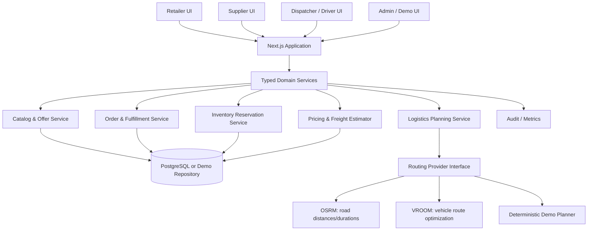

# Architecture — Hackathon Prototype

## Recommendation
Use a **modular monolith** for the hackathon, not microservices. A modular monolith is faster to build, easier to run locally, and easier to debug during a live demo. Keep domain boundaries clean so modules can be separated later if real scale and team ownership justify it.

## Logical modules
- Identity and demo role context
- Organization and supplier authorization
- Catalog and offers
- Inventory and reservations
- Orders and fulfillment allocations
- Pricing and freight estimation
- Logistics planning and route execution
- Delivery proof and status timeline
- Dashboard/analytics
- Audit and notifications

## Suggested technology
- Next.js + TypeScript for web application and server-side operations.
- Tailwind CSS plus a coherent accessible component library.
- PostgreSQL/Supabase for persistence, if the team has configured credentials.
- Local seeded repository behind a service interface as a fallback for a no-credential demo.
- Leaflet and OpenStreetMap for the visual map if tiles/network are available.
- OSRM for road-distance/time estimates and VROOM for vehicle routing only after successful integration tests.
- Vitest or Jest for unit/integration tests; Playwright for critical end-to-end flow if time permits.

## Architecture principle
UI components must call typed domain services. Domain services enforce rules. Persistence adapters store/retrieve data. Routing and payment are provider interfaces with explicit simulated implementations for the hackathon.

## Runtime modes
### Mode A — persisted prototype
Use Supabase/PostgreSQL with migrations and appropriate authorization policies. This is preferred if credentials and time are available.

### Mode B — local demo
Use a typed in-memory/local seeded repository for a predictable demonstration. Label persistence limitations clearly. Do not store secrets or rely on browser state for security.

## Routing capability boundary
- OSRM can provide route/distance/duration services based on configured OpenStreetMap road data; it is not the business policy engine.
- VROOM can optimize vehicle-routing problems for supported inputs and constraints; it does not automatically encode every marketplace rule.
- The application must pre-filter jobs, validate constraints, interpret the result, and reject infeasible plans.
- If either service is unavailable, show a clearly labelled demo plan or an actionable error. Never silently claim live optimization.

## External provider interfaces
- `RoutingProvider`: `estimateMatrix`, `planRoutes`, `healthCheck`
- `PaymentProvider`: `createPaymentIntent`, `getPaymentStatus` — simulated only in hackathon unless a real provider is configured
- `NotificationProvider`: `sendOrderUpdate` — local in-app notification for demo
- `CatalogImportProvider`: future integration; not required for prototype

## Deployment
Keep one deployable web app for the prototype. Use environment variables for provider URLs and credentials. Include a health/status panel for integrations and label every unconfigured provider as unavailable or simulated.
