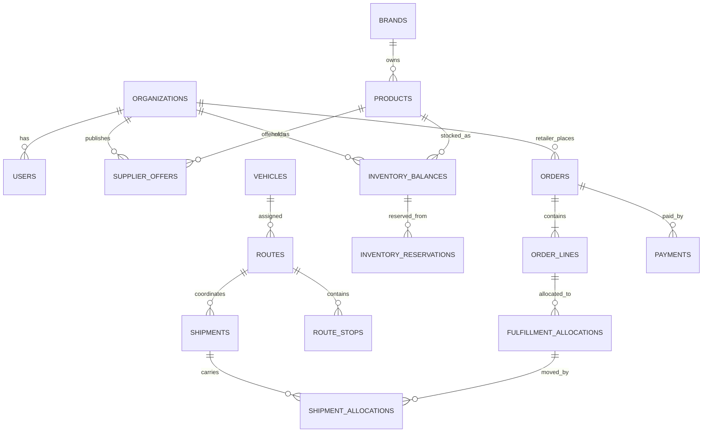

# Data Model — Prototype

## Design rules
- Use stable UUIDs or similarly unique IDs.
- Use `created_at` and `updated_at` timestamps.
- Use integer paise for money.
- Keep product, supplier offer, stock, order, fulfillment allocation, shipment, route and payment separate.
- Preserve confirmed order-line price snapshots.
- Store synthetic demo records with an explicit `is_demo` or scenario identifier.
- Do not model every future production accounting edge case in the hackathon schema; implement the critical boundaries cleanly.

## Core entities
| Entity | Purpose | Key fields |
|---|---|---|
| `organizations` | Retailers, manufacturers, distributors, logistics providers | id, name, organization_type, demo_status |
| `users` | Demo identities and roles | id, organization_id, display_name, role |
| `retailer_locations` | Delivery locations | id, retailer_org_id, address_label, latitude, longitude, service_region |
| `brands` | Brand identities | id, name |
| `products` | Canonical SKU catalog | id, brand_id, name, sku_code, category, base_unit, units_per_case, weight_g, volume_cm3 |
| `supplier_authorizations` | Which distributor is authorized for which brand/SKU/region | id, manufacturer_org_id, distributor_org_id, brand_id, product_id nullable, region, status |
| `supplier_offers` | Supplier-specific commercial offer | id, supplier_org_id, product_id, unit_price_paise, currency, moq, order_increment, lead_time_hours, status, valid_until |
| `inventory_balances` | Stock per supplier location and product | id, supplier_org_id, location_id, product_id, on_hand_qty, reserved_qty |
| `orders` | Retailer commercial order | id, retailer_org_id, delivery_location_id, order_number, status, currency, subtotal_paise, estimated_freight_paise, estimated_tax_paise, estimated_total_paise |
| `order_lines` | Requested SKU quantity and confirmed price snapshot | id, order_id, product_id, requested_qty, fulfilled_qty, unit_price_paise_snapshot, line_discount_paise, status |
| `inventory_reservations` | Quantity held against a line/allocation | id, order_line_id, inventory_balance_id, quantity, status, expires_at |
| `fulfillment_allocations` | Which supplier fulfills what quantity | id, order_line_id, supplier_org_id, inventory_balance_id, allocated_qty, status, reason_code |
| `vehicles` | Route capacity | id, provider_org_id, name, max_weight_g, max_volume_cm3, active |
| `delivery_jobs` | Physical pickup/delivery work | id, fulfillment_allocation_id, pickup_location_id, delivery_location_id, weight_g, volume_cm3, planning_window, status |
| `routes` | Vehicle route plan | id, vehicle_id, status, estimated_distance_m, estimated_duration_s, estimated_freight_paise, planner_type |
| `route_stops` | Ordered stops | id, route_id, sequence_number, stop_type, location_id, delivery_job_id nullable, status, arrival_estimate |
| `shipments` | Physical shipment record | id, route_id nullable, status, carrier_org_id nullable |
| `shipment_allocations` | Link shipment to fulfillment allocations | id, shipment_id, fulfillment_allocation_id, quantity |
| `payments` | Demo payment state | id, order_id, amount_paise, provider, status, external_reference nullable |
| `audit_events` | Critical action history | id, actor_user_id, entity_type, entity_id, action, details_json, created_at |

## Relationship summary

## Required database constraints
- `unit_price_paise >= 0`, quantities positive where appropriate, stock non-negative.
- `reserved_qty >= 0 AND reserved_qty <= on_hand_qty`.
- Unique `order_number`.
- Unique `(route_id, sequence_number)`.
- Unique provider idempotency key for order/payment operations if persistence supports it.
- Foreign keys for all referenced entities.
- Do not delete confirmed orders or audit events in normal UI operations; use cancellation/status transitions.
- Validate that allocated quantities do not exceed requested quantities unless the product requirement explicitly permits over-fulfillment (default: it does not).

## Inventory reservation transaction
Within one transaction:
1. Lock the inventory balance row(s) or use an atomic conditional update.
2. Verify `on_hand_qty - reserved_qty >= requested allocation`.
3. Increase `reserved_qty`.
4. Insert reservation and allocation records.
5. Confirm order only if all required validations succeed, or apply an explicitly supported partial-allocation policy.
6. Commit.
7. On cancellation/expiry, release the reservation exactly once.

## Prototype seed scenario
Seed at least:
- 3 retailer stores in a small fictionalized/sample Jaipur service area
- 1 manufacturer/brand organization
- 2 authorized distributor organizations
- 6–10 products across a few FMCG categories
- Multiple offers for at least 3 SKUs
- One product where direct offer is best, one where distributor offer is best, and one where split fulfillment is needed
- 2 vehicles with different capacities
- 3–5 delivery jobs that can form a feasible shared route
- One deliberate infeasible job to demonstrate capacity/eligibility rejection

All seed records must be marked as synthetic demo data.
