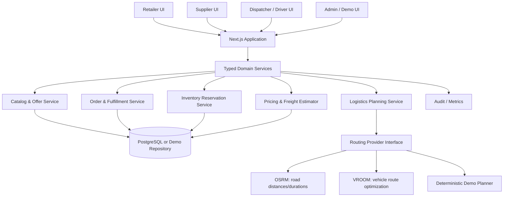
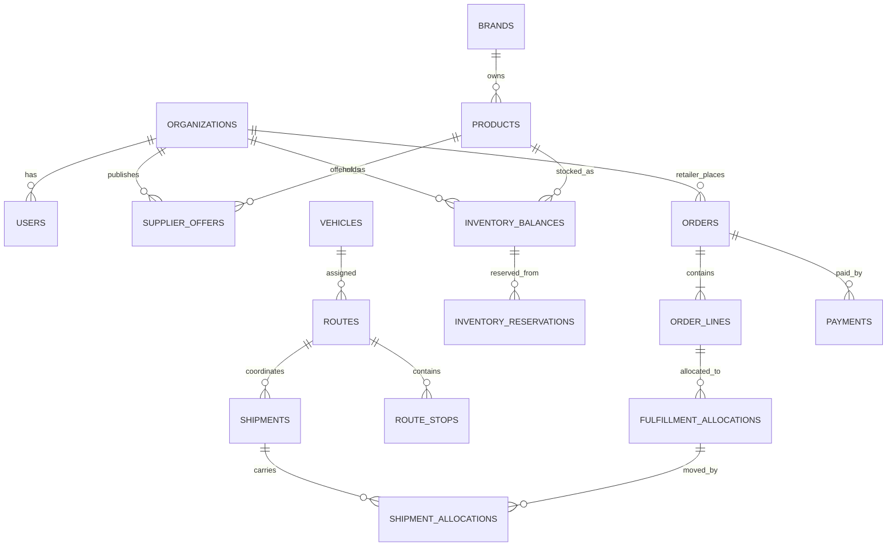

# Kirana Setu — Consolidated Antigravity Hackathon Handoff

This single file consolidates the project brief and build rules. For the modular version, use the ZIP package.


---


# Antigravity Instructions — Kirana Setu

## Mission
Build a polished, reliable hackathon prototype for Kirana Setu, a B2B procurement and shared-logistics platform for Indian kirana stores. The approved product decisions are a hybrid supplier model and shared multi-stop delivery.

## Authority order
If instructions conflict, use this order:
1. Explicit user decisions in the conversation.
2. `PROJECT_BRIEF.md` and approved decisions in `DECISIONS.md`.
3. `REQUIREMENTS.md`, `BUSINESS_RULES.md`, `USER_FLOWS.md`, and `API_CONTRACT.md`.
4. Architecture and implementation details in other documents.
5. Your own assumptions, which must never override an approved decision.

## Anti-hallucination rules
1. Do not claim access to Kisan Setu source code, private services, credentials, or internal data. Its file is inspiration only.
2. Do not invent a real supplier, real authorization, live inventory feed, delivery partner, payment integration, or government integration. Use clearly labelled synthetic demo data.
3. When a requirement is ambiguous, write it to `OPEN_QUESTIONS.md`, describe the impact, propose a default, and label that default as unapproved. For the hackathon, use the safest reversible demo behavior.
4. Do not claim route optimization is live unless a real routing engine has been configured and its output verified. A deterministic simulated optimizer must be labelled “Demo optimization”.
5. Do not claim payments, tax calculations, GST/TCS compliance, invoices, credit underwriting, or e-way bills are production-ready. Demo billing is illustrative only and must be marked accordingly.
6. Do not hardcode fake success for buttons. Each visible action must work, show validation/errors, or be explicitly labelled as a disabled future feature.
7. Do not add features outside the MVP before the core end-to-end scenario works.
8. Do not use secrets in source code. Put variable names in `.env.example`; keep actual credentials local.
9. Never trust frontend-only authorization. If a backend is present, validate permissions on the server and apply database access controls.
10. Never mark a test as passed unless it was actually run and passed. Report unrun tests honestly.

## Required working method
1. Inspect the repository and all project docs before coding.
2. Summarize the architecture and identify contradictions/open questions.
3. Create `docs/BUILD_STATUS.md` with implemented, tested, simulated, blocked, and not-started features.
4. Build in milestones from `IMPLEMENTATION_PLAN.md`.
5. Before each milestone, list files to be changed and acceptance criteria.
6. After each milestone, run available type checks, lint, tests, and build; fix regressions before moving on.
7. Keep schema migrations versioned and repeatable if a database is used.
8. Add tests for stock reservation, supplier eligibility, order split, route capacity, and idempotent order creation.
9. Keep documentation updated when behavior changes.
10. At completion, provide exact setup commands, demo credentials, test results, known limitations, and a 3-minute presentation flow.

## Code quality
- TypeScript strict mode where feasible.
- Avoid `any` unless justified and isolated.
- Use typed domain models and a service/repository boundary so local demo data can later be replaced by Supabase/API implementations.
- Use integer paise or a decimal-safe money representation; do not use floating-point arithmetic for authoritative money totals.
- Use stable IDs and timestamps.
- Make order confirmation and inventory reservation atomic when using a real database.
- Keep order, fulfillment, shipment, route, and payment states separate.
- Use accessible labels, keyboard-operable controls, responsive layouts, and visible loading/empty/error states.

## Demo labels
Use labels such as:
- “Sample data”
- “Simulated payment”
- “Demo route plan”
- “Estimated freight”
- “Prototype only — not a tax invoice”

## Definition of done
A feature is done only when its UI, domain logic, error states, tests, and documentation are aligned. A screenshot alone does not count as functional completion.


---


# Project Brief — Kirana Setu

## 1. Problem
Independent kirana stores often purchase goods through fragmented channels and may have limited visibility into product availability, supplier choice, minimum order quantities, delivery costs, and order status. Small orders from many stores can also be inefficient to deliver separately.

Kirana Setu proposes one digital workflow for product discovery, supplier selection, order placement, fulfillment visibility, and coordinated local delivery.

## 2. Product vision
Give a kirana owner a simple way to discover products from verified demo suppliers, compare available offers, place a basket, understand the estimated landed cost, and track delivery. Give suppliers and logistics operators a clear operational view of demand and fulfillment.

## 3. Core differentiator
**Hybrid procurement + shared logistics:**
- A product may be offered directly by a manufacturer/brand.
- The same product may also be offered by an authorized distributor or C&F partner.
- Orders are allocated only to eligible supplier offers in the demo data.
- Compatible fulfillment tasks can be consolidated into a shared route with multiple delivery stops.
- The UI explains why an offer or route was selected and shows estimated savings only when the comparison is calculated from explicit demo assumptions.

## 4. Primary users
1. **Kirana retailer:** discovers items, compares offers, places orders, sees order status and delivery estimate.
2. **Manufacturer/brand operator:** manages product offers, stock and orders assigned to the brand.
3. **Distributor/C&F operator:** manages authorized offers, local stock and assigned orders.
4. **Logistics dispatcher/driver:** reviews planned shared routes, stop sequence, load, and delivery status.
5. **Platform administrator:** manages demo organizations, product catalog, supplier authorizations and scenario data.

## 5. Hackathon objective
Demonstrate the product’s value in a convincing, end-to-end, interactive prototype. The judging experience should make the problem, workflow, logistics logic, and measurable benefit easy to understand in 3–5 minutes.

## 6. Explicit non-goals for the prototype
- Production marketplace or real-money settlement
- Real supplier onboarding, KYC, credit scoring, or supplier authorization verification
- Production GST/TCS, tax advice, tax filing, or legal compliance certification
- Real inventory integrations with brands/distributors
- Guaranteed live road traffic or real dispatch
- Production-grade returns, accounting ledger, dispute management, or e-way bill generation
- National-scale multi-region operations
- Claims of AI prediction unless an actual model and evaluation are implemented

## 7. Demo story
A retailer in a sample Jaipur locality needs several FMCG products. The retailer compares direct-brand and authorized-distributor offers, adds products to a basket, sees any MOQ/case-pack rules, confirms a sample order, and receives an order summary. The operations view shows orders from nearby retailers being grouped into a compatible shared delivery run. A dispatcher reviews the route, load, stops, and estimated distance/time. The driver marks a stop delivered with a simulated proof-of-delivery record. Dashboards show the sample scenario’s order, fulfillment, and route metrics.

All locations, companies, prices, stock levels, orders and performance numbers are synthetic unless the team documents a verified external source.


---


# Requirements and Acceptance Criteria

## Priority definitions
- **P0:** Must work for the demo.
- **P1:** Valuable if time permits.
- **P2:** Post-hackathon.

## P0 — Retailer experience
- Browse a seeded catalog with product name, brand, category, unit/case size, indicative price, stock/availability, supplier type, minimum quantity, and delivery estimate.
- Compare offers for the same SKU across direct manufacturer and authorized distributor channels.
- Add/remove items and change quantities.
- Enforce minimum order quantity and case-pack multiples with clear validation.
- Show item subtotal, estimated freight, taxes as illustrative only if shown, and total estimated payable. Clearly label tax/invoice figures as illustrative.
- Confirm an order and show an order reference and order details.
- View order lifecycle and fulfillment allocation. If a line is split, show each source and quantity.
- Display empty, loading, validation, and error states.

## P0 — Supplier operations
- Show the supplier’s assigned orders and relevant order lines.
- Allow a demo operator to accept/reject an order line or mark it ready for pickup, with permitted state transitions.
- Only show records belonging to the selected demo supplier organization.
- Distinguish manufacturer, distributor, and C&F partner roles.

## P0 — Shared logistics
- Show eligible pending deliveries and a route planning action.
- Group compatible delivery jobs using a documented, deterministic rule.
- Respect configured vehicle capacity and required pickup-before-delivery precedence if represented in the scenario.
- Present route stops in order, vehicle/load utilization, estimated distance/time, and which orders each stop serves.
- If using a real OSRM/VROOM integration, identify it and show errors/fallback. Otherwise display “Demo route plan”.
- Allow dispatcher to assign/confirm a route and a driver to advance stop status.
- Support a list-based route view even if map tiles or routing services are unavailable.

## P0 — Admin and demo controls
- Seeded scenario with realistic but synthetic retailers, suppliers, products, offers, stock, vehicles, and delivery locations.
- Reset/reload demo scenario without corrupting the database.
- A role switcher is acceptable for hackathon demonstration only; label it “Demo role switcher”. It must not be mistaken for production authorization.
- Dashboard numbers must derive from current demo data rather than arbitrary hardcoded totals.

## P0 — Technical quality
- Responsive design, especially at laptop presentation size and mobile retailer size.
- No broken navigation or inert primary actions.
- Type-check/build succeeds.
- Critical business rules have automated tests or documented manual verification.
- README has exact setup instructions and limitations.

## P1
- English/Hindi language toggle for core labels.
- Product search and category filters.
- Low-stock and delivery exception alerts.
- Freight allocation explanation (weight-based default, with all weights synthetic).
- CSV export of demo orders or route manifest.
- QR-like order reference or proof-of-delivery photo placeholder, clearly simulated.

## P2
- Real payment gateway, real supplier ERP integrations, credit/ledger, tax invoice automation, returns/RMA, advanced analytics, production identity verification, multi-city scaling.

## Acceptance criteria for the hackathon demo
1. A judge can understand the product in 30 seconds from the landing/dashboard.
2. The retailer can complete a seeded purchase without manually editing data.
3. The system displays which supplier fulfills each order line and why.
4. At least two retailer deliveries can appear on a single shared route when the scenario’s compatibility rules allow it.
5. The route screen shows ordered stops, estimated distance/time, and vehicle capacity status.
6. Route stop statuses can be advanced and the retailer-facing order status updates.
7. A refresh does not silently erase the order if persistence is enabled; if local-only state is used, this limitation is disclosed.
8. No unsupported live-integration or compliance claims appear in the UI or pitch.
9. Critical tests pass and the team can explain the routing and fulfillment logic.


---


# Business Rules and Invariants

## 1. Supplier and offer model
- A catalog SKU is a product identity; a supplier offer is a particular supplier’s commercial offer for that SKU.
- An offer includes supplier organization, supplier type, SKU, price, unit of measure, case pack, MOQ, available quantity, lead time, service region, and offer validity.
- Distributor offers may be used only when the demo data explicitly marks the distributor as authorized for the brand/SKU and relevant region.
- Never infer authorization solely because a distributor lists a product.
- Offer eligibility is checked at order time, not only when the product page loads.
- For the prototype, supplier authorization is seeded and illustrative, not independently verified.

## 2. Units, pack sizes, and money
- Store quantities in a consistent base unit and preserve the displayed order unit/case pack.
- Quantity must satisfy MOQ and pack multiple. For example, if case pack = 12 and MOQ = 12, valid quantities are 12, 24, 36—not 13.
- Use integer paise for INR calculations or a decimal-safe money type.
- Keep a price snapshot on confirmed order lines: unit price, quantity, discount, freight allocation, and applicable illustrative tax fields. Later offer edits must not rewrite confirmed order values.
- Round only at defined calculation boundaries; document the rounding rule.
- Never add tax twice or describe a prototype estimate as a tax invoice.

## 3. Order and fulfillment separation
- An order is the retailer’s commercial request.
- An order line represents a requested SKU and quantity.
- A fulfillment allocation identifies the supplier/location and quantity assigned to fulfill a line.
- A shipment is a physical movement; it may carry fulfillment allocations for multiple orders if compatible.
- A route is an ordered plan for a vehicle; it may contain multiple pickup and delivery stops.
- Payment status is separate from order status. A delivered shipment does not automatically mean payment has settled.
- For a hackathon prototype, payment may be simulated and must be labelled.

## 4. Inventory reservation
- Available-to-promise = on-hand quantity − already reserved quantity − any safety stock configured for the demo.
- Never allocate more than available-to-promise.
- Reservation and order confirmation must be atomic in a real database. In a local prototype, the service layer must at least serialize updates and tests must cover competing orders.
- Reservation states: `held`, `committed`, `released`, `expired`.
- Cancellation releases only quantities that have not been picked/shipped, according to the implemented demo rule.
- Never silently substitute a product. A substitution requires explicit retailer acceptance.

## 5. Hybrid sourcing policy
Recommended demo policy, configurable in code:
1. Filter offers by active status, supplier authorization, region, MOQ/pack validity, and stock.
2. Estimate item cost and delivery contribution for each eligible offer.
3. Rank eligible offers by total estimated retailer cost, then delivery estimate, then a stable tie-breaker.
4. Allocate the line to the best eligible offer.
5. If one offer cannot supply the full quantity, split only if split fulfillment is enabled and the retailer-facing UI makes the split explicit.
6. Never choose an unauthorized distributor just because it is closer or cheaper.
7. Record the reason for allocation (e.g., “eligible, sufficient stock, lower estimated landed cost”). Do not describe this as an AI decision.

## 6. Shared-logistics compatibility
Two jobs may be consolidated only if they satisfy the demo’s declared rules:
- Same planning window or compatible dispatch window.
- Compatible origin/pickup sequence and supplier handling requirements.
- Vehicle capacity in weight and volume is not exceeded.
- Service region and delivery windows are compatible.
- Any cold-chain, fragile, hazardous, or other special handling flags are compatible; for the demo, either enforce the flags or exclude such SKUs.
- A shared route does not mean multiple sellers’ inventory is merged. It means physical delivery jobs are coordinated; commercial ownership and invoice responsibility remain separately recorded.

## 7. Freight allocation
- Route-level estimated freight is allocated across included orders using the chosen configured method.
- Prototype default: weight-based pro-rata if all demo SKUs have a positive known weight; otherwise use a disclosed equal-per-stop fallback.
- Formula for weight method: order freight share = route freight estimate × (order’s allocated shipment weight / total allocated shipment weight).
- Display “estimated freight” and the method used.
- If a route includes multiple pickup origins, the demo must either model pickup legs or explicitly state that its simplified estimate excludes some origin complexity.
- Estimated savings = baseline cost − shared-route estimate. The baseline definition and inputs must be visible. Never invent a savings percentage.

## 8. State transitions
- Order: `draft → placed → confirmed → partially_fulfilled | fulfilled → completed`; cancellation is allowed only from states defined by policy.
- Order line: `pending → allocated → partially_fulfilled → fulfilled`; may be `rejected` or `cancelled` with a reason.
- Shipment: `planned → assigned → picked_up → in_transit → delivered`; exceptions include `failed` or `cancelled`.
- Route: `draft → optimized → assigned → in_progress → completed`; may be `cancelled`.
- Stop: `pending → arrived → delivered`; exception statuses include `failed_attempt` and `skipped`, with reason required.
- These are separate state machines. Do not derive all statuses from one generic `status` field.

## 9. Auditability
Record actor, action, entity, timestamp, and relevant before/after values for critical demo operations such as price change, order confirmation, allocation, route confirmation, and delivery status.


---


# User Flows

## Flow A — Retailer places an order
1. Retailer opens catalog.
2. Searches or filters products.
3. Opens SKU offer comparison.
4. Reviews supplier type, price, MOQ/case pack, stock status, estimated delivery and estimated freight.
5. Adds valid quantities to basket.
6. Reviews line totals and estimated order total.
7. Confirms order.
8. System validates offer status, region, authorization, pack rules and available-to-promise.
9. System reserves stock and creates supplier fulfillment allocations.
10. Retailer sees order confirmation, source allocation and status timeline.

### Failure paths
- Stock changed: explain the unavailable quantity and ask the retailer to revise or accept an explicit split.
- MOQ/case multiple invalid: show the valid minimum and increment.
- No eligible offer: show unavailable; do not fabricate supply.
- Order submit retried: same idempotency key must not create duplicate orders.
- Partial fulfillment: show each supplier allocation and remaining quantity.

## Flow B — Supplier accepts and prepares order
1. Supplier signs into the supplier workspace.
2. Views assigned order lines.
3. Opens order details, quantity, delivery location and requested window.
4. Accepts or rejects with reason.
5. Marks accepted items as ready for pickup.
6. The operations view updates using persistence/realtime if configured; otherwise refreshes from the demo repository.

## Flow C — Dispatcher plans shared route
1. Dispatcher opens eligible delivery jobs.
2. Selects a planning window and vehicle.
3. System excludes incompatible jobs and explains exclusion reasons.
4. Route planner returns an ordered stop list, load utilization, distance/time estimate and estimated route cost.
5. Dispatcher reviews the plan and confirms it.
6. Driver view shows assigned stops.
7. Driver marks pickup/delivery progress.
8. Retailer order timeline reflects delivery progress.

## Flow D — Admin manages demo scenario
1. Admin opens scenario dashboard.
2. Reviews sample retailers, suppliers, offers, stock, vehicles and jobs.
3. Can reset to the initial scenario.
4. Sees visible labels indicating sample data and simulated features.
5. Can inspect build status and open questions.

## Flow E — Judge-facing presentation
1. Start on a clear problem/solution dashboard.
2. Demonstrate supplier offer comparison.
3. Place an order and show supplier allocation.
4. Switch to operations and show multiple retailers’ jobs.
5. Plan/confirm a shared route.
6. Advance one delivery stop.
7. Show updated order status and a small set of scenario-derived KPIs.
8. Explain what is real in the prototype, what is simulated, and what would be integrated next.


---


# Architecture — Hackathon Prototype

## Recommendation
Use a **modular monolith** for the hackathon, not microservices. A modular monolith is faster to build, easier to run locally, and easier to debug during a live demo. Keep domain boundaries clean so modules can be separated later if real scale and team ownership justify it.

## Logical modules
- Identity and demo role context
- Organization and supplier authorization
- Catalog and offers
- Inventory and reservations
- Orders and fulfillment allocations
- Pricing and freight estimation
- Logistics planning and route execution
- Delivery proof and status timeline
- Dashboard/analytics
- Audit and notifications

## Suggested technology
- Next.js + TypeScript for web application and server-side operations.
- Tailwind CSS plus a coherent accessible component library.
- PostgreSQL/Supabase for persistence, if the team has configured credentials.
- Local seeded repository behind a service interface as a fallback for a no-credential demo.
- Leaflet and OpenStreetMap for the visual map if tiles/network are available.
- OSRM for road-distance/time estimates and VROOM for vehicle routing only after successful integration tests.
- Vitest or Jest for unit/integration tests; Playwright for critical end-to-end flow if time permits.

## Architecture principle
UI components must call typed domain services. Domain services enforce rules. Persistence adapters store/retrieve data. Routing and payment are provider interfaces with explicit simulated implementations for the hackathon.



## Runtime modes
### Mode A — persisted prototype
Use Supabase/PostgreSQL with migrations and appropriate authorization policies. This is preferred if credentials and time are available.

### Mode B — local demo
Use a typed in-memory/local seeded repository for a predictable demonstration. Label persistence limitations clearly. Do not store secrets or rely on browser state for security.

## Routing capability boundary
- OSRM can provide route/distance/duration services based on configured OpenStreetMap road data; it is not the business policy engine.
- VROOM can optimize vehicle-routing problems for supported inputs and constraints; it does not automatically encode every marketplace rule.
- The application must pre-filter jobs, validate constraints, interpret the result, and reject infeasible plans.
- If either service is unavailable, show a clearly labelled demo plan or an actionable error. Never silently claim live optimization.

## External provider interfaces
- `RoutingProvider`: `estimateMatrix`, `planRoutes`, `healthCheck`
- `PaymentProvider`: `createPaymentIntent`, `getPaymentStatus` — simulated only in hackathon unless a real provider is configured
- `NotificationProvider`: `sendOrderUpdate` — local in-app notification for demo
- `CatalogImportProvider`: future integration; not required for prototype

## Deployment
Keep one deployable web app for the prototype. Use environment variables for provider URLs and credentials. Include a health/status panel for integrations and label every unconfigured provider as unavailable or simulated.


---


# Data Model — Prototype

## Design rules
- Use stable UUIDs or similarly unique IDs.
- Use `created_at` and `updated_at` timestamps.
- Use integer paise for money.
- Keep product, supplier offer, stock, order, fulfillment allocation, shipment, route and payment separate.
- Preserve confirmed order-line price snapshots.
- Store synthetic demo records with an explicit `is_demo` or scenario identifier.
- Do not model every future production accounting edge case in the hackathon schema; implement the critical boundaries cleanly.

## Core entities
| Entity | Purpose | Key fields |
|---|---|---|
| `organizations` | Retailers, manufacturers, distributors, logistics providers | id, name, organization_type, demo_status |
| `users` | Demo identities and roles | id, organization_id, display_name, role |
| `retailer_locations` | Delivery locations | id, retailer_org_id, address_label, latitude, longitude, service_region |
| `brands` | Brand identities | id, name |
| `products` | Canonical SKU catalog | id, brand_id, name, sku_code, category, base_unit, units_per_case, weight_g, volume_cm3 |
| `supplier_authorizations` | Which distributor is authorized for which brand/SKU/region | id, manufacturer_org_id, distributor_org_id, brand_id, product_id nullable, region, status |
| `supplier_offers` | Supplier-specific commercial offer | id, supplier_org_id, product_id, unit_price_paise, currency, moq, order_increment, lead_time_hours, status, valid_until |
| `inventory_balances` | Stock per supplier location and product | id, supplier_org_id, location_id, product_id, on_hand_qty, reserved_qty |
| `orders` | Retailer commercial order | id, retailer_org_id, delivery_location_id, order_number, status, currency, subtotal_paise, estimated_freight_paise, estimated_tax_paise, estimated_total_paise |
| `order_lines` | Requested SKU quantity and confirmed price snapshot | id, order_id, product_id, requested_qty, fulfilled_qty, unit_price_paise_snapshot, line_discount_paise, status |
| `inventory_reservations` | Quantity held against a line/allocation | id, order_line_id, inventory_balance_id, quantity, status, expires_at |
| `fulfillment_allocations` | Which supplier fulfills what quantity | id, order_line_id, supplier_org_id, inventory_balance_id, allocated_qty, status, reason_code |
| `vehicles` | Route capacity | id, provider_org_id, name, max_weight_g, max_volume_cm3, active |
| `delivery_jobs` | Physical pickup/delivery work | id, fulfillment_allocation_id, pickup_location_id, delivery_location_id, weight_g, volume_cm3, planning_window, status |
| `routes` | Vehicle route plan | id, vehicle_id, status, estimated_distance_m, estimated_duration_s, estimated_freight_paise, planner_type |
| `route_stops` | Ordered stops | id, route_id, sequence_number, stop_type, location_id, delivery_job_id nullable, status, arrival_estimate |
| `shipments` | Physical shipment record | id, route_id nullable, status, carrier_org_id nullable |
| `shipment_allocations` | Link shipment to fulfillment allocations | id, shipment_id, fulfillment_allocation_id, quantity |
| `payments` | Demo payment state | id, order_id, amount_paise, provider, status, external_reference nullable |
| `audit_events` | Critical action history | id, actor_user_id, entity_type, entity_id, action, details_json, created_at |

## Relationship summary


## Required database constraints
- `unit_price_paise >= 0`, quantities positive where appropriate, stock non-negative.
- `reserved_qty >= 0 AND reserved_qty <= on_hand_qty`.
- Unique `order_number`.
- Unique `(route_id, sequence_number)`.
- Unique provider idempotency key for order/payment operations if persistence supports it.
- Foreign keys for all referenced entities.
- Do not delete confirmed orders or audit events in normal UI operations; use cancellation/status transitions.
- Validate that allocated quantities do not exceed requested quantities unless the product requirement explicitly permits over-fulfillment (default: it does not).

## Inventory reservation transaction
Within one transaction:
1. Lock the inventory balance row(s) or use an atomic conditional update.
2. Verify `on_hand_qty - reserved_qty >= requested allocation`.
3. Increase `reserved_qty`.
4. Insert reservation and allocation records.
5. Confirm order only if all required validations succeed, or apply an explicitly supported partial-allocation policy.
6. Commit.
7. On cancellation/expiry, release the reservation exactly once.

## Prototype seed scenario
Seed at least:
- 3 retailer stores in a small fictionalized/sample Jaipur service area
- 1 manufacturer/brand organization
- 2 authorized distributor organizations
- 6–10 products across a few FMCG categories
- Multiple offers for at least 3 SKUs
- One product where direct offer is best, one where distributor offer is best, and one where split fulfillment is needed
- 2 vehicles with different capacities
- 3–5 delivery jobs that can form a feasible shared route
- One deliberate infeasible job to demonstrate capacity/eligibility rejection

All seed records must be marked as synthetic demo data.


---


# API Contract — Prototype-Level Contract

The implementation may use Next.js server actions or REST handlers, but it must preserve these domain operation boundaries. If REST is used, prefix routes with `/api/v1`.

## Conventions
- JSON request/response.
- Use authenticated identity or explicit demo-role context; never trust a client-supplied organization ID without validating membership.
- Return a stable error shape: `{ "error": { "code": "...", "message": "...", "details": {} } }`.
- Use idempotency keys for create-order and simulated payment operations.
- Amounts are integer paise. Include currency (`INR`).
- All estimates must have `estimate_type` and `is_simulated` metadata where relevant.

## Key operations
| Method | Operation | Purpose |
|---|---|---|
| `GET` | `/api/v1/products` | Browse catalog and eligible offers |
| `GET` | `/api/v1/products/{productId}/offers` | Compare supplier offers |
| `POST` | `/api/v1/orders` | Validate basket, reserve stock, create order |
| `GET` | `/api/v1/orders/{orderId}` | Order, lines, allocations and timeline |
| `POST` | `/api/v1/orders/{orderId}/cancel` | Request cancellation if allowed |
| `POST` | `/api/v1/supplier-orders/{allocationId}/accept` | Supplier accepts assigned allocation |
| `POST` | `/api/v1/supplier-orders/{allocationId}/ready` | Mark allocation ready for pickup |
| `GET` | `/api/v1/logistics/jobs` | List eligible delivery jobs |
| `POST` | `/api/v1/routes/plan` | Plan a route for a set of jobs and vehicle |
| `POST` | `/api/v1/routes/{routeId}/confirm` | Confirm the reviewed route |
| `POST` | `/api/v1/routes/{routeId}/stops/{stopId}/status` | Update a stop status |
| `GET` | `/api/v1/dashboard/summary` | KPIs derived from scenario data |
| `POST` | `/api/v1/demo/reset` | Reset seeded scenario in demo mode only |

## Example order request
```json
{
  "retailerLocationId": "loc-retailer-01",
  "items": [
    { "productId": "sku-rice-5kg", "offerId": "offer-distributor-01", "quantity": 2 }
  ],
  "idempotencyKey": "demo-order-unique-001"
}
```

## Example order response
```json
{
  "orderId": "ord-demo-1001",
  "orderNumber": "KS-DEMO-1001",
  "status": "confirmed",
  "currency": "INR",
  "subtotalPaise": 120000,
  "estimatedFreightPaise": 8000,
  "estimatedTaxPaise": 0,
  "estimatedTotalPaise": 128000,
  "estimateDisclaimer": "Prototype estimate; not a tax invoice.",
  "allocations": [
    {
      "productId": "sku-rice-5kg",
      "supplierType": "authorized_distributor",
      "quantity": 2,
      "reason": "Eligible offer with sufficient demo stock and lower estimated total cost."
    }
  ]
}
```

## Example route-plan request
```json
{
  "planningWindow": "demo-morning",
  "vehicleId": "vehicle-demo-01",
  "jobIds": ["job-demo-01", "job-demo-02", "job-demo-03"],
  "planner": "demo"
}
```

## Example route-plan response
```json
{
  "routeId": "route-demo-01",
  "plannerType": "deterministic_demo",
  "isSimulated": true,
  "stops": [
    { "sequence": 1, "type": "pickup", "label": "Demo Distributor A" },
    { "sequence": 2, "type": "delivery", "label": "Kirana Store A" },
    { "sequence": 3, "type": "delivery", "label": "Kirana Store B" }
  ],
  "estimatedDistanceMeters": 8400,
  "estimatedDurationSeconds": 2100,
  "capacity": {
    "weightGrams": { "used": 42000, "available": 100000 },
    "volumeCm3": { "used": 65000, "available": 180000 }
  },
  "disclaimer": "Demo route plan; distance/time values are scenario estimates."
}
```

## Error codes
- `OFFER_NOT_ELIGIBLE`
- `INSUFFICIENT_STOCK`
- `INVALID_PACK_QUANTITY`
- `MOQ_NOT_MET`
- `UNAUTHORIZED_SUPPLIER`
- `ORDER_STATE_CONFLICT`
- `RESERVATION_CONFLICT`
- `ROUTE_CAPACITY_EXCEEDED`
- `INCOMPATIBLE_DELIVERY_JOBS`
- `IDEMPOTENCY_CONFLICT`
- `PROVIDER_UNAVAILABLE`

## Contract tests
For each operation, test successful response, validation failure, authorization failure, duplicate request behavior, and stale state behavior where applicable.


---


# Shared Logistics and Route Planning Specification

## Objective
Reduce avoidable delivery duplication by planning compatible pickup and delivery work together while preserving supplier, order and fulfillment ownership.

## Terminology
- **Order:** retailer’s commercial request.
- **Fulfillment allocation:** quantity assigned to one supplier/location.
- **Delivery job:** operational work to move allocated goods from pickup to retailer.
- **Shipment:** physical grouping of goods.
- **Route:** ordered stops assigned to a vehicle and planning window.
- **Stop:** pickup or delivery action at a location.

## Eligibility filter before route planning
A job is eligible only if:
- its allocation is accepted/ready according to the demo workflow;
- pickup and delivery locations are known;
- the planning window is compatible;
- the job’s service/handling flags are compatible with the vehicle;
- required authorization and fulfillment validations have already passed;
- it is not already assigned to an active route.

## Capacity
For each route, total carried load at each route segment must not exceed the vehicle’s configured weight or volume capacity. If multiple pickups and deliveries exist, load should be updated after each stop. A simple total-load check is acceptable only for the prototype if all jobs are picked up before the delivery sequence; document that simplification.

## Multi-origin handling
A route with multiple supplier origins requires pickup stops before delivery stops for the goods collected at each origin. The route planner must preserve pickup-before-delivery precedence. If the chosen solver configuration cannot represent a constraint, enforce it in application logic or simplify the demo scenario.

## Route planning modes
### Preferred: real configured providers
- OSRM: road network distance/duration estimates or matrices.
- VROOM: vehicle routing optimization for supported job/vehicle inputs.
- Validate service health, response schema, capacity, precedence and returned route.
- Store provider name/version/configuration where possible.
- If provider fails, report failure or use a labelled demo fallback only with dispatcher consent.

### Fallback: deterministic demo planner
- Use known synthetic coordinates or a predefined scenario.
- Group jobs by planning window and compatibility.
- Sort stops by a deterministic nearest-neighbor or predefined sequence.
- Estimate distances using a documented method. Straight-line distance must not be presented as road distance.
- Mark the plan `plannerType = deterministic_demo` and `isSimulated = true`.
- This mode is acceptable for the hackathon if transparent.

## Freight allocation
Prototype default:
1. Compute route-level estimated freight from a clearly stated synthetic rate or route estimate.
2. Allocate by shipment weight if every order has valid weight.
3. Otherwise allocate equally per delivery stop and label the fallback.
4. Apply paise rounding; assign any remainder deterministically so allocated shares sum exactly to route freight.
5. Display the allocation basis to the dispatcher and retailer.

## UI output
- Route map (if available) plus equivalent ordered stop list.
- Vehicle name, capacity, load used and utilization percentage.
- Ordered stops, pickup/delivery type, retailer label, order references.
- Estimated distance and duration with simulation/live label.
- Estimated route cost and per-order freight allocation.
- Excluded jobs and reasons.
- Warnings for infeasible capacity, missing coordinates or incompatible windows.

## KPIs
Calculate from actual demo records:
- eligible delivery jobs
- jobs included in shared route
- estimated route distance
- estimated route cost
- estimated cost per delivered order
- vehicle capacity utilization
- completed vs pending stops
- estimated savings versus a defined baseline (only if both values are calculated from the same assumptions)

## Required test scenarios
- Two compatible retailers consolidated into one route.
- Job excluded due to wrong planning window.
- Job excluded due to unauthorized/ineligible allocation.
- Vehicle capacity exceeded.
- Multiple pickup origins with precedence.
- Missing coordinate/provider failure.
- Repeated planning request does not create duplicate active route unintentionally.


---


# UI/UX Specification — Hackathon Quality Bar

## Visual direction
Build a modern, trustworthy B2B operations product—not a generic admin template. Use a restrained palette, generous spacing, clear hierarchy, high-contrast text, consistent iconography, crisp tables/cards, and a strong primary action per screen. Prefer a polished desktop operations view and a fast mobile retailer flow.

## Design principles
- Show the business value in the first viewport.
- Use realistic synthetic data and believable operational details.
- Keep the primary retailer journey short.
- Make complex sourcing/logistics decisions explainable.
- Distinguish status with both text and color; never rely on color alone.
- Use INR formatting consistently.
- Show explicit “Sample data”, “Demo route plan”, “Estimated freight”, and “Prototype only” labels where appropriate.
- Every primary button must work and show feedback.

## Required screens
### 1. Landing / overview
- One-sentence value proposition.
- Clear role entry points: Retailer, Supplier, Dispatcher, Admin.
- Compact metrics derived from the seeded scenario.
- “Start demo” action.

### 2. Retailer catalog
- Search, categories and availability filters.
- Product cards with product/brand, pack size, offer price, stock label, supplier type and delivery estimate.
- Compare offers action.
- Add-to-basket quantity control that enforces MOQ/case pack.

### 3. Offer comparison
- Side-by-side manufacturer and distributor offers.
- Price, MOQ, pack size, availability, estimated delivery and estimated freight.
- “Why this offer?” explanation: eligibility, stock and estimated total cost.
- Authorization badge only when backed by the seeded authorization record; label sample supplier data.

### 4. Basket and checkout
- Quantity and pack validation.
- Item subtotal, estimated freight, illustrative tax if included, estimated total.
- Supplier allocation preview.
- Disclaimer: “Prototype estimate; not a tax invoice.”
- Confirm order button with loading/success/error feedback.

### 5. Order details
- Order reference and status timeline.
- Lines and price snapshots.
- Supplier allocation and split fulfillment if applicable.
- Shipment/route linkage when assigned.
- Delivery status and demo proof of delivery.

### 6. Supplier workspace
- Assigned order lines, quantities, delivery locations, status.
- Accept/reject and mark ready for pickup actions.
- Reason required for rejection.
- Supplier identity and role clearly visible.

### 7. Dispatcher operations
- Queue of eligible jobs with reason and compatibility.
- Vehicle selector with capacity.
- Plan shared route action.
- Map + stop list; list remains available if map fails.
- Load utilization, distance/time, cost estimate and exclusions.
- Confirm route action.

### 8. Driver route view
- Mobile-first stop cards.
- Pickup/delivery details and order references.
- Mark arrived, delivered, or failed attempt with reason.
- Proof-of-delivery is simulated unless actual upload storage exists.

### 9. Admin / scenario controls
- Demo scenario overview, sample entities, reset scenario.
- Integration health/status labels.
- Build limitations and open questions.

## Accessibility and responsiveness
- Keyboard-accessible controls and visible focus states.
- Proper labels for inputs.
- Modal/dialog focus management.
- Responsive layout at 360px mobile width, tablet and desktop.
- Loading skeletons, empty states, error messages, and success confirmations.
- Avoid tiny text in the judge-facing dashboard.

## Content tone
Use concise, professional copy. Avoid unsupported claims such as “AI-powered” unless a real evaluated model exists. Prefer “eligible-offer selection” and “shared route planning”.


---


# Test Plan

## Test layers
1. Unit tests for business rules and calculation functions.
2. Integration tests for order creation, reservations, allocations and route planning.
3. Authorization tests for role and organization boundaries if a backend exists.
4. End-to-end tests for the judge-facing workflow.
5. Manual demo rehearsal on the actual presentation device and network.

## Critical unit tests
- Valid MOQ and pack multiples accepted; invalid multiples rejected.
- Offer selection ignores inactive, out-of-region or unauthorized offers.
- Lowest eligible estimated total cost wins under the approved demo policy.
- Split fulfillment never exceeds requested quantity.
- Confirmed price snapshot remains unchanged after offer price changes.
- Money calculations use paise/decimal-safe arithmetic.
- Weight-based freight allocations sum exactly to route freight after rounding.
- Capacity checks reject overweight/oversized route plans.
- Pickup precedes delivery for each job.
- Invalid state transitions are rejected.
- Duplicate idempotency key does not create a duplicate order.

## Integration tests
- Order placement reserves stock and writes allocations.
- Failed reservation leaves no partially confirmed order unless explicit partial allocation is supported.
- Cancellation releases the correct reservation exactly once.
- Supplier acceptance changes the correct allocation only.
- Route confirmation links jobs and prevents accidental double assignment.
- Driver stop update updates the route and relevant retailer timeline.
- Dashboard metrics reflect underlying scenario records.

## Security tests
- Retailer A cannot read Retailer B’s orders.
- Supplier A cannot modify Supplier B’s inventory or allocations.
- Dispatcher cannot change offer pricing unless explicitly authorized.
- Client-supplied organization IDs cannot bypass server-side authorization.
- Demo role switching is clearly restricted to demo mode.
- Secrets are not present in source control.

## End-to-end demo test
1. Open retailer role.
2. Compare offers for a seeded product.
3. Add valid quantity and confirm order.
4. Verify order number and allocation.
5. Open supplier role and accept/prepare the allocation.
6. Open dispatcher role and plan a route with at least two compatible deliveries.
7. Verify capacity and ordered stops.
8. Confirm route and advance one stop.
9. Verify retailer timeline updates.
10. Open dashboard and confirm KPIs reflect the actions.

## Performance and reliability checks
- App loads and navigates without console errors.
- Seed reset works repeatedly.
- Empty/error states are visible when providers are unavailable.
- Route screen remains usable without map tiles.
- Run lint, type check, tests and production build where configured.

## Evidence
Maintain `docs/BUILD_STATUS.md` with date, command, pass/fail result, and known limitations. Capture screenshots of the core workflow and a route screen for the submission.


---


# Implementation Plan — Hackathon Prototype

## Milestone 0 — Inspect and plan
- Read all project docs.
- Inspect current repository and identify existing work.
- Record assumptions and contradictions in `OPEN_QUESTIONS.md`.
- Produce `docs/BUILD_STATUS.md`.
**Exit:** scope and architecture understood; no unresolved blocker is silently assumed.

## Milestone 1 — Product shell and visual system
- Set up Next.js, TypeScript, linting and tests.
- Create responsive navigation and role workspaces.
- Establish typography, spacing, color, components, status badges and layout.
- Seed synthetic scenario data.
**Exit:** all main screens exist, navigation works, no broken primary actions.

## Milestone 2 — Catalog and offer comparison
- Implement products, supplier offers and authorization eligibility.
- Implement search/filter and offer comparison.
- Add MOQ and case-pack validation.
**Exit:** retailer can compare offers and add valid quantities.

## Milestone 3 — Order and inventory
- Implement basket, checkout, order creation and order details.
- Implement reservations and supplier allocation.
- Snapshot prices and record allocation reasons.
**Exit:** order can be placed, no oversell in tested scenarios, order details are correct.

## Milestone 4 — Supplier workflow
- Supplier order queue.
- Accept/reject and ready-for-pickup transitions.
- Timeline and audit events.
**Exit:** supplier actions change the appropriate order/allocation state.

## Milestone 5 — Shared logistics
- Create delivery jobs from ready allocations.
- Filter compatibility and plan route.
- Add vehicle capacity, stops, estimates and route confirmation.
- Add real routing integration only if time allows and it is verified; otherwise deterministic demo planner.
**Exit:** at least two compatible jobs share a feasible route and the UI discloses planner mode.

## Milestone 6 — Driver and metrics
- Mobile stop list and status updates.
- Proof-of-delivery simulation.
- Dashboard metrics derived from scenario records.
**Exit:** delivery progress updates retailer status and metrics.

## Milestone 7 — Hardening and presentation
- Run tests, lint, type checks and build.
- Fix visible defects.
- Rehearse the demo on a clean browser session.
- Confirm reset behavior and demo credentials.
- Prepare screenshots, 3-minute script and limitations slide.
**Exit:** reliable end-to-end demonstration with honest limitations.

## Time allocation guidance
For a short hackathon, prioritize milestones 1–3, then a narrow but real shared-route flow in milestone 5. Do not spend most of the time on complex production tax/payment features or microservices. A coherent end-to-end flow is more valuable than many unfinished screens.

## Definition of done
A milestone is complete only when its acceptance criteria pass, errors are handled, tests are run or limitations recorded, and the build status is updated.


---


# 3–5 Minute Hackathon Demo Script

## Opening — 20 seconds
“Small kirana stores often buy through fragmented supply channels. Kirana Setu lets a store compare eligible manufacturer and distributor offers, place an order, and coordinate delivery with nearby stores through shared multi-stop routes.”

## Act 1 — Retailer procurement — 60 seconds
1. Open the retailer workspace.
2. Search for a product.
3. Compare the manufacturer offer with authorized distributor offers.
4. Explain MOQ, pack size, availability and estimated delivery.
5. Add a valid quantity and show the estimated total.
6. Confirm the order.
**Point to make:** The system does not just list products; it compares eligible supply options and explains its selection.

## Act 2 — Fulfillment transparency — 40 seconds
1. Open order details.
2. Show the price snapshot and supplier allocation.
3. Switch to the relevant supplier workspace.
4. Accept the order and mark it ready for pickup.
**Point to make:** Commercial order, supplier allocation and physical delivery are separate records.

## Act 3 — Shared logistics — 75 seconds
1. Open dispatcher view.
2. Show pending jobs and the selected vehicle capacity.
3. Plan a route with at least two compatible retailer deliveries.
4. Show ordered stops, load utilization, estimated distance/time and freight allocation.
5. Explain that the demo route is simulated unless a verified OSRM/VROOM integration is active.
6. Confirm route and open the driver view.
**Point to make:** Multiple retailers can share a compatible route while supplier ownership and order records remain distinct.

## Act 4 — Delivery and outcomes — 40 seconds
1. Mark a stop delivered.
2. Show the retailer order timeline update.
3. Show scenario-derived dashboard metrics.
**Point to make:** The operational action is connected to the retailer’s view and the metrics.

## Closing — 20 seconds
“The prototype demonstrates the core loop: eligible sourcing, transparent order allocation, and shared delivery planning. The next phase is validating the model with real retailers and suppliers, then integrating verified inventory, routing, payment and compliance services.”

## Judge questions to prepare for
- **Is the route optimization live?** State exactly which provider is configured, or say it is the deterministic demo planner.
- **Are suppliers real?** Explain whether records are synthetic and how authorization would be verified in a pilot.
- **Are payments and tax invoices live?** State that the prototype uses simulated/illustrative billing unless real integrations have been completed and reviewed.
- **How is savings calculated?** Show the baseline formula and input values; do not quote a percentage without a reproducible calculation.
- **What is the moat?** Explain the combination of hybrid supplier eligibility, order-level transparency, and coordinated local delivery—not merely an online catalog.


---


# Open Questions and Explicit Assumptions

This document prevents assumptions from being mistaken for confirmed requirements.

| Question | Prototype default | Risk if wrong | Status |
|---|---|---|---|
| Who is seller of record? | Do not decide for production; show supplier allocation and illustrative order summary only | Invoices, tax, liability and returns depend on it | Open |
| Who invoices the retailer? | Prototype invoice-like summary labelled “not a tax invoice” | Incorrect invoice treatment | Open |
| Who collects payment? | Simulated payment status only | Settlement, compliance and refund complexity | Open |
| Is split fulfillment allowed? | Yes for demo only when explicitly shown to retailer | Multiple delivery fees and partial orders | Confirmed for prototype behavior; commercial policy open |
| What is the real supplier authorization source? | Seeded authorization records labelled synthetic | Counterfeit/unauthorized supply risk | Open |
| Which freight allocation is commercially accepted? | Weight-based if all weights exist; otherwise equal per stop with disclosure | Perceived unfairness or inaccurate margin | Open |
| What delivery SLA is promised? | Display estimate only; no guarantee | Customer trust and liability | Open |
| Which routing provider is configured? | Deterministic demo planner until OSRM/VROOM is verified | Demo could misrepresent route quality | Open |
| Which city is the pilot? | Use sample Jaipur-area scenario for demo only | Operational assumptions may not generalize | Open |
| Is credit enabled? | No credit/BNPL feature in MVP | Credit risk and collections | Deferred |
| Are returns implemented? | Show only if core flow is stable; no blanket 7-day rule | FMCG expiry/damage policy differs by seller/category | Deferred |
| Are tax figures accurate? | Omit or label illustrative; no compliance claim | Legal/tax exposure | Open |

## Decision process
For every resolved question, add:
- decision
- rationale
- owner/approver
- date
- affected requirements/schema/APIs
- migration or UI changes required

Record approved decisions in `DECISIONS.md`.


---


# Decision Log

## Approved project decisions
### D-001 — Hybrid supply model
**Decision:** Support direct manufacturer/brand offers and authorized distributor/C&F offers.
**Reason:** Gives the demo a realistic sourcing comparison and fallback path.
**Consequences:** Supplier offers and authorization records must be separate entities.

### D-002 — Shared logistics
**Decision:** Plan compatible multi-stop delivery routes across multiple retailer jobs.
**Reason:** This is a core differentiator, not a cosmetic map feature.
**Consequences:** Need delivery jobs, vehicles, route plans, ordered stops, capacity checks and clear route estimates.

### D-003 — Hackathon prototype scope
**Decision:** Prioritize one end-to-end workflow over a broad unfinished platform.
**Reason:** Reliability and explainability matter in a live judging environment.
**Consequences:** Payment, tax, credit, ERP integrations and production onboarding are deferred or simulated with visible labels.

### D-004 — Modular monolith
**Decision:** Start with a modular monolith.
**Reason:** Reduces integration and deployment risk for a small hackathon team.
**Consequences:** Maintain domain boundaries and provider interfaces; do not split into microservices prematurely.

### D-005 — Truthful demo data
**Decision:** Use synthetic scenario data and label it.
**Reason:** No real supplier integrations or verified authorization data are provided.
**Consequences:** Demo claims must distinguish measured scenario outputs from market-wide claims.

## Change control
Do not silently override these decisions. Propose a change with reason, scope impact, migration impact, test impact and approval status.


---


# Security, Privacy and Compliance Boundaries

## Hackathon security minimum
- Never commit API keys, database passwords, service-role keys, or payment secrets.
- Use `.env.local` locally and commit only `.env.example`.
- Validate authorization on the server if a backend is used.
- Apply database row-level security for tenant-owned data if Supabase/PostgreSQL is used.
- Limit demo role switching to an explicit demo environment; do not confuse it with production auth.
- Use synthetic names, addresses, phone numbers and GST-like identifiers only if clearly marked fake. Prefer not to use real personal data.
- Avoid collecting sensitive data that is not required for the prototype.
- Do not store raw card numbers, CVV, UPI PINs or bank credentials.
- Log critical actions without leaking secrets or unnecessary personal data.

## Production topics requiring separate review
- Seller-of-record, invoicing and contract structure.
- GST registration, invoice contents, marketplace obligations and any applicable TCS/TDS treatment.
- E-way bill applicability based on actual transaction, goods, value and movement facts.
- Payment aggregator/provider rules, refunds and settlement.
- Retailer and supplier KYC/verification.
- Data protection, notice/consent, retention, deletion and incident response.
- Product-specific handling, expiry, damage, recall and returns policies.
- Carrier contracts, insurance and proof-of-delivery retention.

This document is not legal, tax, or accounting advice. The prototype must not claim compliance certification. Verify current rules with official sources and qualified professionals before a live pilot.


---


# Research Notes and Evidence Policy

## Purpose
Keep product assumptions and external evidence separate. This prototype can be demonstrated using synthetic data; any claims about the Indian kirana market, supplier behavior, savings, legal requirements or competitor capabilities need source-backed validation before appearing as facts in a pitch.

## Research questions for the team
1. How do target kirana stores currently procure FMCG products: direct brands, wholesalers, distributors, C&F agents, digital B2B apps, or a mix?
2. What are typical minimum order quantities, case-pack requirements, delivery windows, payment terms and return policies for the categories selected for the pilot?
3. How do local distributors verify territory/product authorization?
4. Which costs can realistically be shared across multiple retailer deliveries, and who pays them?
5. What supplier/retailer density is needed to make consolidation useful?
6. Which competitor features are confirmed by current product documentation versus marketing claims?
7. Which tax, invoicing, payment, privacy and movement rules apply to the actual proposed business model?

## Source hierarchy
Prefer:
1. Official government/regulator documentation for legal and tax questions.
2. Official product documentation for technology capabilities.
3. Company documentation and product terms for competitor features.
4. Reputable research/industry reports with methodology and publication date.
5. Interviews or surveys with clearly described sample size and limitations.
6. General articles only as secondary context.

## Research log template
| Claim or question | Finding | Source URL/title | Publisher | Published/accessed date | Evidence quality | How it affects design |
|---|---|---|---|---|---|---|
| Example: route matrix support | Fill after checking current docs | | | | | |

## Evidence labels
- **Verified:** supported by a current authoritative source or documented test.
- **Observed:** collected from interviews or prototype test; state sample size.
- **Assumption:** plausible but not yet validated.
- **Synthetic demo input:** invented solely to demonstrate behavior.
- **Decision:** product choice, not an external fact.

## Technical reference starting points
- Next.js documentation: https://nextjs.org/docs
- TypeScript handbook: https://www.typescriptlang.org/docs/
- Supabase documentation: https://supabase.com/docs
- OSRM API documentation: https://project-osrm.org/docs/
- VROOM project/documentation: https://github.com/VROOM-Project/vroom
- OpenStreetMap copyright and attribution: https://www.openstreetmap.org/copyright

Check current versions and terms at implementation time. Do not assume a public demo endpoint has production-grade availability, service levels or unrestricted usage.

## Pitch discipline
Do not state “saves 30%”, “98% on-time”, “AI optimized”, “compliant with GST”, or similar claims unless the team can show the calculation, test, evidence and scope. For hackathon demonstration, use phrases such as “in this synthetic scenario, the route estimate is X versus the defined baseline Y”.


---


# Demo Data Specification

## Purpose
Create one deterministic scenario that makes the hybrid sourcing and shared-logistics behavior visible without depending on live partners.

## Synthetic scenario requirements
- Fictional/demo organization names or clearly marked sample organizations.
- A sample service area around Jaipur may be used, but locations and performance figures must be labelled synthetic.
- 3 retailers with distinct delivery points.
- 1 manufacturer and at least 2 distributors.
- 6–10 products across 3–4 categories.
- At least 3 products with multiple offers.
- At least one direct offer that wins under the configured selection policy.
- At least one authorized distributor offer that wins.
- At least one scenario requiring a split or showing why split fulfillment is unavailable.
- At least 2 vehicles with different capacity.
- At least 3 compatible delivery jobs.
- At least 1 deliberately excluded job with an understandable reason.
- Different stock quantities so reservation logic can be demonstrated.
- A product with MOQ/case-pack validation.

## Data integrity
- All quantities and prices must be plausible demo inputs, not claims about current market pricing.
- Store weights and volumes in consistent units.
- Give every location coordinates if a map is shown.
- Ensure the planned route is feasible with its chosen vehicle.
- Derive dashboard metrics from the seeded records and user actions.
- Include a reset function that returns to the initial deterministic scenario.
- Do not seed actual credentials, phone numbers or personal information.

## Suggested demonstration setup
1. Retailer A orders two SKUs.
2. SKU 1 selects a direct offer.
3. SKU 2 selects an eligible distributor offer due to stock, lead time or total estimate.
4. Retailer B has an existing compatible delivery job.
5. Dispatcher consolidates jobs for A and B into a route if constraints permit.
6. Driver marks a delivery complete.
7. Dashboard reflects updated route and delivery state.


---


# Pitch Narrative and Limitations

## Problem
Kirana stores need a clearer way to compare supply options and coordinate deliveries. Traditional fragmented purchasing can make availability, supplier choice, and delivery economics difficult to see in one place.

## Solution
Kirana Setu combines hybrid sourcing from manufacturers and authorized distributors with shared multi-stop delivery planning. It connects procurement decisions to fulfillment and logistics operations in one transparent workflow.

## What is distinctive
- Offer comparison across supplier channels.
- Explicit eligibility and authorization checks.
- Order-level supplier allocation and split-fulfillment visibility.
- Shared route planning with capacity and stop sequencing.
- Estimated freight allocation with a visible formula.
- One operational timeline from order to delivery.

## Prototype claims that are safe if implemented
- “The prototype compares seeded offers under a documented rule.”
- “The route planner checks the configured demo constraints.”
- “The dashboard calculates metrics from this scenario’s data.”
- “The prototype shows how multiple retailer deliveries could be coordinated.”

## Claims to avoid without evidence
- Guaranteed cost reduction or delivery SLA.
- Live inventory or real supplier authorization.
- Real-time traffic optimization unless integrated and verified.
- Production payment settlement or tax compliance.
- AI-based demand forecasting without a trained/evaluated model.
- National scalability based only on a local prototype.

## Honest limitations slide
- Synthetic demo data and scenario.
- Routing may be simulated; state exactly which mode is active.
- No live supplier ERP or distributor inventory feeds.
- No real payments, settlements, or tax invoices.
- Commercial policies, compliance and pilot economics require validation.


---


# Environment and Setup Contract

## Required repository files
- `.env.example` contains variable names and safe placeholder values only.
- `.gitignore` excludes `.env.local`, secrets, build artifacts and local database files.
- `README.md` documents exact install, dev, test, lint and build commands.

## Example variable names
```dotenv
NEXT_PUBLIC_APP_NAME="Kirana Setu Demo"
NEXT_PUBLIC_MAP_TILE_URL=""
DATABASE_URL=""
NEXT_PUBLIC_SUPABASE_URL=""
NEXT_PUBLIC_SUPABASE_ANON_KEY=""
SUPABASE_SERVICE_ROLE_KEY=""
OSRM_BASE_URL=""
VROOM_BASE_URL=""
ROUTING_MODE="demo"
PAYMENT_MODE="simulated"
```

Do not require every variable if the related provider is not configured. Validate environment variables at startup and show a clear integration status. Never expose a service-role key through a `NEXT_PUBLIC_` variable.

## Expected scripts
The actual scripts depend on the chosen package manager, but README should document equivalents for:
- development server
- lint
- typecheck
- unit tests
- end-to-end tests if configured
- production build
- seed/reset demo data

Do not claim a command exists until it has been added to `package.json`.
